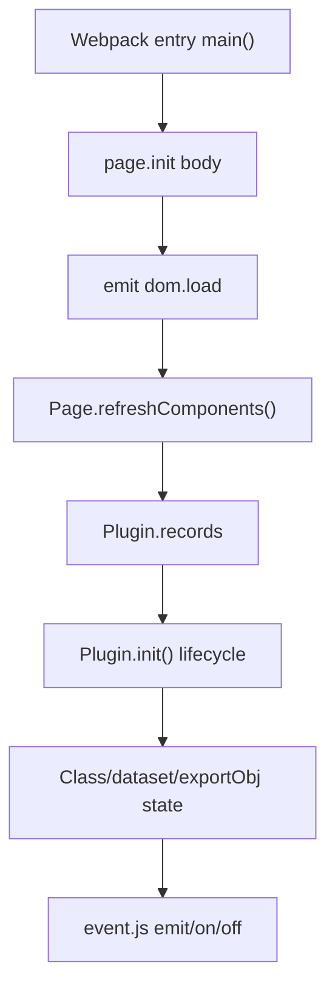

# Client Architecture

No page boots `client/js/index.js` anymore; the legacy HTML pages (`client/pages/`) were removed. `/property` and `/document` are the Vue 3 app in `client/src/` (`router.ts`, `store.ts`, `pages/Property.vue`, `pages/PropertySitemap.vue`, `pages/Document.vue`) and are server-rendered from `entry-server.ts`.


## Scope

This document describes the current client runtime in this repo. It is focused on code-verified behavior in:

- `client/js/core/*`
- `client/js/plugins/*`
- `client/scss/*`

For boot order, `main()` → `page.init()` → Router → `dom.load` / SPA inject (including duplicate-init pitfalls), see **[`docs/client-js-lifecycle.md`](docs/client-js-lifecycle.md)**. Router `push` / `replace` / `goto` contract: [§4](docs/client-js-lifecycle.md#4-client-router-contract).

## Design Model

The client follows a declarative plugin model:

1. HTML declares behavior with `data-role`.
2. `Page` scans the DOM and discovers role nodes.
3. `Plugin` registry resolves and initializes role handlers.
4. Plugin instance state is represented by classes, dataset, and instance exports.

This keeps markup expressive while avoiding per-page imperative bootstrap code.

## Runtime Flow

High level: webpack entry → `main()` registers plugins and runs `page.init()` (page-specific `init`/`load`/`render`, e.g. property `Router`) → first `emit('dom.load')` → `refreshComponents` for `[data-role]` nodes. SPA updates call `emit('dom.load')` again after HTML inject.



Full sequence diagrams: [`docs/client-js-lifecycle.md`](docs/client-js-lifecycle.md).

## Core Modules

### `client/js/core/page.js`

- Owns page-level lifecycle and context (`ctx`).
- Emits page events such as initial DOM load and updates.
- Performs role-based component refresh and plugin re-initialization.

### `client/js/core/plugin.js`

- Registers plugin definitions (`name`, options, lifecycle hooks).
- Tracks plugin instances and maps each DOM node to its instance id.
- Provides init/render/load lifecycle sequencing.

### `client/js/core/event.js`

- Provides `on`, `once`, `off`, `emit`, `trigger`.
- Supports namespaced custom events (`event.namespace`) and selected native events.
- Used as cross-plugin communication channel and page lifecycle bus.

### `client/js/core/dom.hook.js`

- Hooks DOM write paths (like `innerHTML` updates) to prevent stale plugin references.
- Helps keep plugin lifecycle consistent when dynamic HTML is injected.

### `client/js/core/def.js`

- Shared utility helpers for plugin state APIs.
- `defBool` / `defEnum` patterns create standardized methods tied to class-state behavior.

## Plugin Authoring Pattern

Most plugins follow this shape:

- File: `client/js/plugins/_<name>.js`
- Export object with:
  - `name`
  - `defaultOpt`
  - lifecycle methods (`init`, `load`, `render`, `destroy` depending on plugin)
- Registration through `client/js/plugins/index.js`.

Common conventions:

- Use `data-target` and related attributes for wiring.
- Toggle CSS classes for state changes rather than inline styles where possible.
- Use core event helpers instead of ad-hoc global listeners.

### `list-dict` (key/value grid)

Responsive definition list for property facts and similar data.

```html
<ul class="list-dict" data-role="list-dict">
  <li>
    <abbr class="key" title="List price">Price</abbr>
    <span class="value">$425,000</span>
  </li>
</ul>
```

- **Columns:** `repeat(auto-fill, minmax(calc(var(--list-dict-item-width) - var(--g2) * 2), 1fr))` — same idea as `.result > ul` in `property.scss`. Default `--list-dict-item-width: 320px`; override with `data-item-width` on the root.
- **Vue:** property detail renders this structure in `client/src/components/DetailBodyFacts.vue`.

## CSS and Theme System

Token names, `:root` vs `body` alias rules, and the token audit live in **[`docs/css-design-system.md`](docs/css-design-system.md)**.

### SCSS organization

- Entry: `client/scss/index.scss`
- Aggregation: `client/scss/base.scss` with `@forward` modules.
- Component-level partials: `_button.scss`, `_modal.scss`, `_header.scss`, etc.

### Theme model

- Core visual tokens are CSS custom properties.
- Base theme defaults live in SCSS.
- Dark mode behavior is controlled with theme variable overrides.

## Router and property pages

`/property*` is Vue SSR (`client/src/pages/Property.vue`, `PropertySitemap.vue`, routes in `client/src/router.ts`). The old EJS property SPA (`client/pages/property/*.js`, `renderEjs.js`) was removed in `chore/ejs-retire`. [`client/js/core/router.js`](client/js/core/router.js) remains for the legacy runtime.

## Page Entry Structure

One Vite entry: `client/src/main.ts`. Pages are Vue routes in `client/src/router.ts`. There are no static HTML pages.

## Practical Guidelines

- Prefer extending `client/js/core/*` utilities over duplicating behavior in plugins.
- Keep plugin responsibilities narrow: one role, one purpose.
- Treat class names as state contracts between JS and SCSS.
- Clean up listeners/timers in plugin teardown paths.
- Keep docs in sync when plugin attributes or lifecycle behavior changes.

## Known Drift / Cleanup Targets

These are implementation observations and should be treated as follow-up work:

- Some plugins still contain legacy jQuery-style patterns.
- A few CSS utility names and forwards appear inconsistent.
- Theme token naming has minor typo risk in defaults.

Address these in code changes, then update this doc accordingly.
