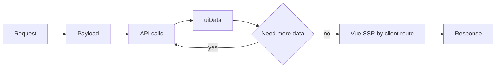

# Server refactor

Business logic stays in route configuration. Each request step logs with the same context so a person or an AI can trace payload, API calls, mapping, and the response. Vue SSR renders `uiData`. Pinia owns client state. Vuex in `client/src/store.ts` is the store to leave behind.

## Request flow



Two URLs for one page:

- `/requestPath` returns the HTML page.
- `/api/requestPath` returns `uiData` only.

## uiData

One object defines a page:

```ts
{
  seo: { title, h1, description },
  httpHead: [],
  metadata: [],
  data: { user, geo, /* page data */ },
}
```

- `seo` — title, h1, description.
- `httpHead` — link, meta, and preload entries.
- `metadata` — values for downstream and from upstream: split treatment, GA4 metrics and dimensions, hosts (`appHost`, `cdnHost`, API host), third-party keys such as a Google Maps key.
- `data` — page data (`user`, `geo`, and the rest of the page).

Async page data loads through a Pinia action that calls `/api/requestPath`. Do not add Vuex for new pages.

Current Vue pages still read the flat property state (`title`, `articles`, `detail`, and the rest) from `__INITIAL_STATE__`. Property SSR now also attaches `uiData` on that state so the new shape is in the HTML payload while those pages keep working.

## API layer

- One layer owns the outbound calls a page needs.
- Shared utilities, reused across calls:
  - `uiPayloadToPayload` — request payload to the upstream payload
  - `apiDataToUiData` — upstream body to the page slice of `uiData`
- Each API module has a comment that matches its Swagger docs.
- In dev, log the curl and the raw response. SOA curls already collect on the request via `runWithSoaLogs` in `server/controllers/realestate.ts`.

## Controller configuration

Keep the current config object (`name`, `beforeGet`, `get`, `seo`, `preload`, `onError`) from `server/controllers/configbase.ts`. `BaseController` in `server/controllers/index.ts` looks the config up by `name`.

Changes from that contract:

- `get` returns `uiData`. `server/controllers/property.ts` does that for search and detail. It still builds header, footer, and filter models, and stores the model data on `uiData.data` instead of EJS component wrappers. Sitemap configs still return link components until those pages move to the same shape.
- A route config lists which API steps run and which mapper to apply, so the fetch and the mapping stay out of the controller class.
- Global fields (`user`, `geo`, and later split, GA4, and other third-party context) are filled by one shared mapper, not copied into each route `get`.

## Logging

Each step (payload, each API call, each mapper, SSR) writes a log line with a request id and the step name. In dev the line includes the step detail. `logStep` in `server/controllers/realestate.ts` writes onto the same async store as SOA curls. `loadClassified` in `server/utils/propertyPageState.ts` logs `property.payload`, `property.get`, and `property.page`.

## Sequence

1. Done: this plan, `uiData` on the property SSR state, step logs on the property page load.
2. Done: property and property-sitemap `get` return `uiData`. `/api/property/:geoPath`, `/api/property/search`, and `/api/property/sitemap/*` return that object. `uiPayloadToPayload`, `apiDataToUiData`, and `pageContext` live under `server/page/`.
3. Done: Pinia store in `client/src/store.ts`. `loadPage` fetches `/api/property...` and writes `uiData` into the store. Vuex is removed.
4. Property HTML templates `property.ejs` and `property-sitemap*.ejs` are removed. `/page/:key` and `/sitemap*` still render EJS. Detail partials stay because `test/ejsClientRender.test.js` and `client/pages/property/detailSpa.js` still import them.
