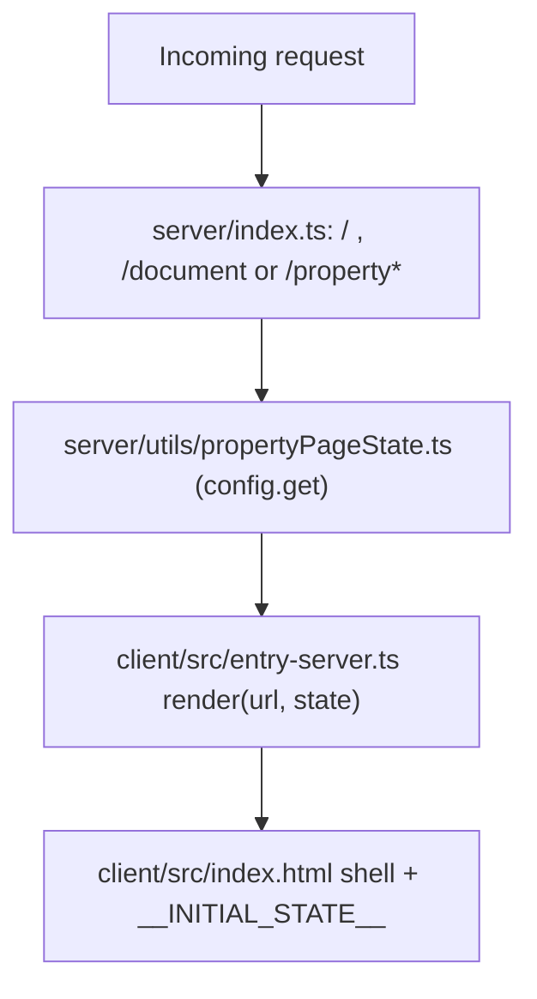

# Server Architecture

Process entry is `server/index.ts`. It serves `dist/`, renders `/property` (search) and `/property/sitemap` with Vue, and mounts TypeScript routers. `/sitemap/*` 301-redirects to `/property/sitemap/*`.


## Scope

This document describes the current server runtime implemented under `server/`.

Key areas:

- Express bootstrap and middleware
- Route topology
- Controller/config contract
- API and SOA proxy behavior
- Local page and comp data under `data/`

## Runtime Entry

Main entry is `server/index.ts`.

At startup it wires:

- API docs (`/api-docs`)
- Compression middleware
- Session middleware
- CORS and headers
- SOA request log context
- Vue SSR for `/`, `/document`, and `/property*`
- Main router (`server/routes/index.ts`)
- Geo Fuse warmup

## Route Topology

Router composition in `server/routes/index.ts`:

- Page and HTML routes via:
  - `sitemap.ts` (`/sitemap*` 301 to `/property/sitemap*`)
- API routes:
  - `/api` -> `server/routes/api.ts`
  - `/api/soa` -> `server/routes/api.soa.ts`

SOA prefixes currently mounted in `server/routes/api.soa.ts`:

- `/api/soa/property/<named>`
- `/api/soa/school/<named>`
- geoarea named routes under `/api/soa/*`

No catch-all proxy (it would expose `SOA_API_KEY` to any caller).

## Request Lifecycle (Page Rendering)

Every HTML page is Vue SSR in `server/index.ts`. There is no server template engine.



JSON routes in `server/routes/api.ts` use `BaseController(req, res, configName)` → `config.beforeGet` → `config.get` → `toData`.

## Controller and Config Contract

`server/controllers/index.ts` (`BaseController`) orchestrates config-driven behavior and registers route configs.

Other modules in `server/controllers/*` (route configs, e.g. `property.ts`) commonly define:

- `name`
- `beforeGet(payload)` (optional)
- `get(payload)` (required; page SEO is part of the returned model)
- `preload(payload)` (optional)

`server/controllers/configbase.ts` contains the contract reference used by this architecture.

### `toData`

`toData` sends JSON `{ code, data, error, cost }` with `data.meta` from `initialMeta`. Vue SSR and the JSON API call the same `config.get()`. Example: property SSR and `GET /api/property/detail/:prId` share [`server/controllers/property.ts`](server/controllers/property.ts).

Listing SOA → metadata → comp models: [`docs/listing-data-pipeline.md`](docs/listing-data-pipeline.md).

## API and Proxy Pattern

### App API (`/api`)

`server/routes/api.ts` serves app-facing endpoints and model mapping helpers.

### SOA API (`/api/soa`)

- Route adapters are split by domain (`property`, `school`, `geoarea`).
- Upstream calls are centralized through fetch helpers in `server/controllers/realestate.ts`.
- Some geo responses are normalized through mapper utilities before returning.

## Data Source Strategy

Comp seeds (footer) and geo data are imported from local `data/` modules. The EJS `/page/:key` route and its `data/page/` sections were retired.

## Dev and Environment Behavior

Environment resolution is controlled in `server/config.ts`:

- development -> `.env` then `.env.local`
- stage -> `.env.stage`
- production -> `.env.production`

Secrets (`SOA_API_KEY`, `SESSION_SECRET`, map keys, NAS credentials) live only in these local env files. They are git-ignored and `.dockerignore`d. Docker gets them at runtime through `env_file` in `docker-compose.yml`, never in the image.

`SESSION_SECRET` is required in production and stage (the server refuses to start without it). In development a random secret is generated per process.

Defaults:

- `PORT=3000`
- webpack dev server port `3001`

## Testing Status (Server Focus)

Included in `npm run test`:

- `test/basecontroller.config.test.js` — BaseController / config contract
- `test/property.get.test.js` — property `get()` return shape (no SOA when no `prId`)
- `test/propertyGeoRedirect.test.js` — property geo canonical redirect
- `helpers/__tests__/property.test.js` — SOA metadata and detail comp mappers
- `helpers/__tests__/datetime.test.js`
- `helpers/__tests__/htmlPath.test.js`
- Root scripts: `test-geo-mapping.js`, `test-auto-detection.js`, `test-dialog-plugin.js`

Run subset:

```bash
npm run test:basecontroller
```

Full suite:

```bash
npm run test
```

No Playwright/e2e in repo; optional UI checks via `npm run test:lighthouse` (Docker + Lighthouse).

The refactor plan (uiData, step logs, Pinia) is [server-refactor.md](server-refactor.md).

## Known Risks to Track

- SOA fetch helper error handling should consistently map upstream failures to explicit HTTP errors.
- Session secret should be supplied via env in all environments.
- A few older abstractions appear underused and may be candidates for cleanup.

Treat this section as an architecture watchlist, not a replacement for issue tracking.
