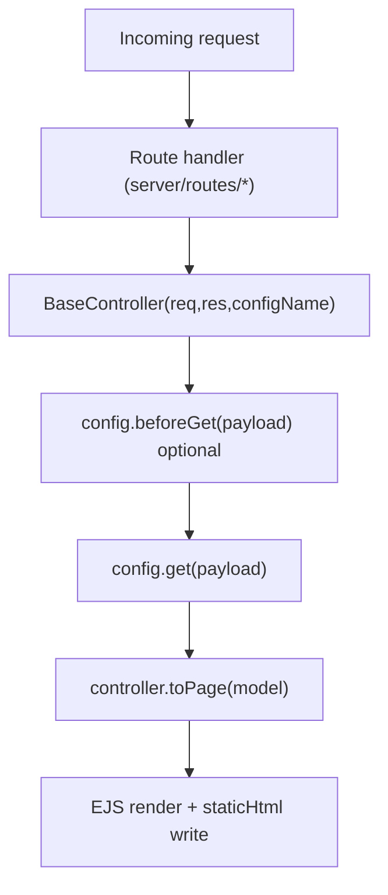

# Server Architecture

Process entry is `server/index.ts`. It serves `dist/`, renders `/property` (search) and `/property/sitemap` with Vue, and mounts TypeScript routers. Page content is read from `data/` through `server/utils/localData.ts`.


## Scope

This document describes the current server runtime implemented under `server/`.

Key areas:

- Express bootstrap and middleware
- Route topology
- Controller/config contract
- API and SOA proxy behavior
- Local page and comp data under `data/`

## Runtime Entry

Main entry is `server/index.ts`.

At startup it wires:

- API docs (`/api-docs`)
- Compression middleware
- Session middleware
- CORS and headers
- SOA request log context
- Vue SSR for `/`, `/document`, and `/property*`
- EJS view engine for remaining HTML routes
- Main router (`server/routes/index.ts`)
- Geo Fuse warmup

## Route Topology

Router composition in `server/routes/index.ts`:

- Page and HTML routes via:
  - `default.ts`
  - `propertySitemap.ts`
  - `property.ts`
  - `sitemap.ts`
  - `page.ts`
- API routes:
  - `/api` -> `server/routes/api.ts`
  - `/api/soa` -> `server/routes/api.soa.ts`

SOA prefixes currently mounted in `server/routes/api.soa.ts`:

- `/api/soa/property/*`
- `/api/soa/school/*`
- `/api/soa/poi/*`
- geoarea and catch-all paths through `/api/soa/*`

## Request Lifecycle (Page Rendering)



## Controller and Config Contract

`server/controllers/index.ts` (`BaseController`) orchestrates config-driven behavior and registers route configs.

Other modules in `server/controllers/*` (route configs, e.g. `property.js`, `page.js`) commonly define:

- `name`
- `beforeGet(payload)` (optional)
- `get(payload)` (required)
- `seo(payload)` (optional)
- `preload(payload)` (optional)

`server/controllers/configbase.ts` contains the contract reference used by this architecture.

### `toPage` vs `toData`

| | `toPage` | `toData` |
|---|----------|----------|
| Output | HTML (`${config.name}.ejs`) | JSON `{ code, data, error, cost }` |
| SEO / breadcrumb / theme | yes | no |
| `getHref` / `getSrc` on model | yes | no |

Both call the same `config.get()`. Example: property SSR and `GET /api/property/detail/:prId` share [`server/controllers/property.ts`](server/controllers/property.ts).

Listing SOA → metadata → comp models: [`docs/listing-data-pipeline.md`](docs/listing-data-pipeline.md).

## API and Proxy Pattern

### App API (`/api`)

`server/routes/api.ts` serves app-facing endpoints and model mapping helpers.

### SOA API (`/api/soa`)

- Route adapters are split by domain (`property`, `school`, `poi`, `geoarea`).
- Upstream calls are centralized through fetch helpers in `server/controllers/realestate.ts`.
- Some geo responses are normalized through mapper utilities before returning.

## Data Source Strategy

Page and comp content is loaded from local `data/` modules by `server/utils/localData.ts`.

## Dev and Environment Behavior

Environment resolution is controlled in `server/config.ts`:

- development -> `.env` then `.env.local`
- stage -> `.env.stage`
- production -> `.env.production`

Defaults:

- `PORT=3000`
- webpack dev server port `3001`

## Testing Status (Server Focus)

Included in `npm run test`:

- `test/basecontroller.config.test.js` — BaseController / `toPage` contract
- `test/property.get.test.js` — property `get()` return shape (no SOA when no `prId`)
- `test/propertyGeoRedirect.test.js` — property geo canonical redirect
- `helpers/__tests__/property.test.js` — SOA metadata and detail comp mappers
- `helpers/__tests__/datetime.test.js`
- `helpers/__tests__/htmlPath.test.js`
- Root scripts: `test-geo-mapping.js`, `test-auto-detection.js`, `test-dialog-plugin.js`

Run subset:

```bash
npm run test:basecontroller
```

Full suite:

```bash
npm run test
```

No Playwright/e2e in repo; optional UI checks via `npm run test:lighthouse` (Docker + Lighthouse).

## Known Risks to Track

- SOA fetch helper error handling should consistently map upstream failures to explicit HTTP errors.
- Session secret should be supplied via env in all environments.
- A few older abstractions appear underused and may be candidates for cleanup.

Treat this section as an architecture watchlist, not a replacement for issue tracking.
